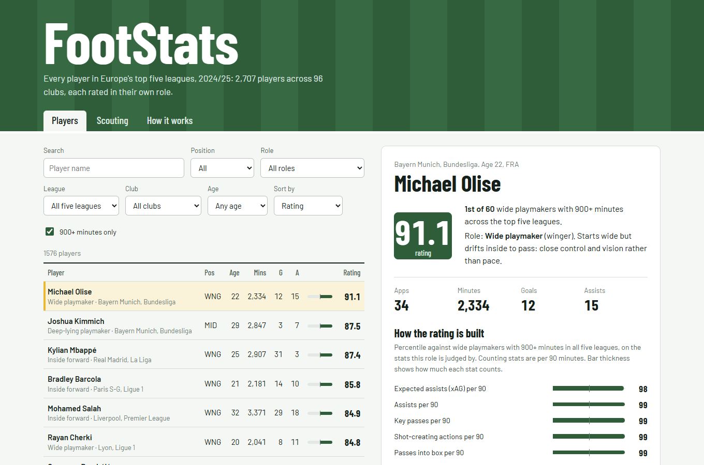
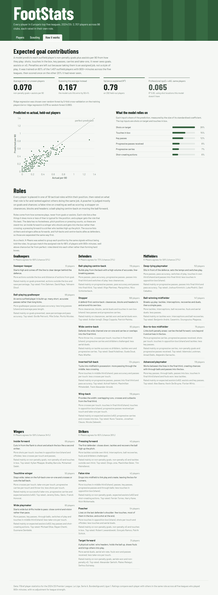
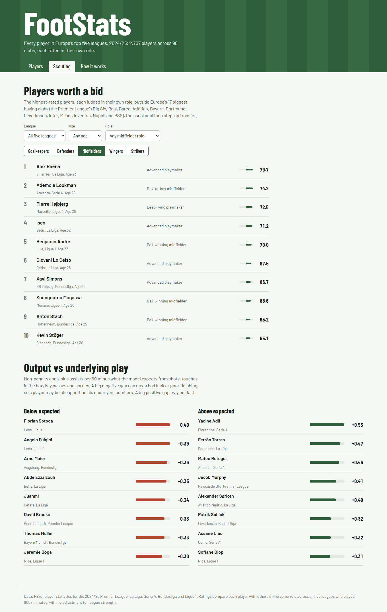
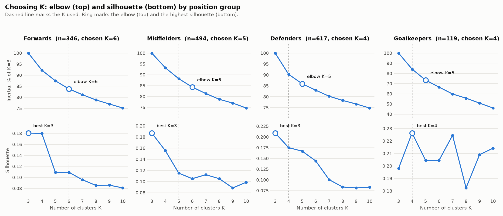
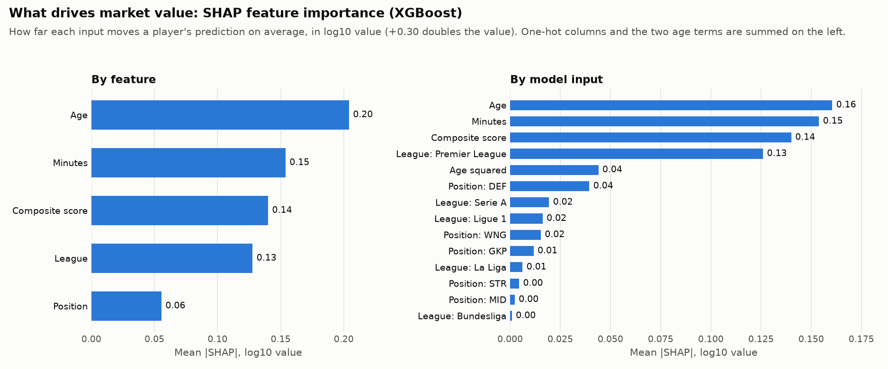
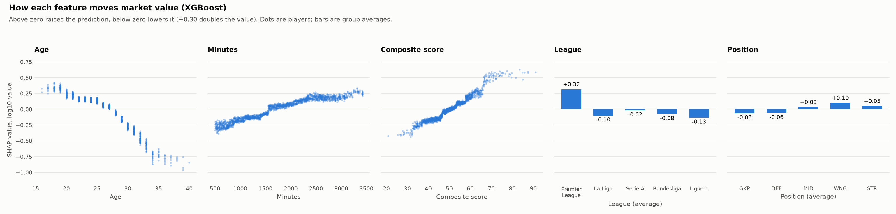

# FootStats

Player analytics for Europe's top five leagues in 2024/25 (Premier League, La Liga, Serie A, Bundesliga, Ligue 1): 18 tactical roles worked out from how each player plays, role-specific ratings, cross-league similar-player search, scouting filters by league and age, and a model that predicts goal contributions from how a player plays. The model is benchmarked against professional xG.

**Stack:** Python, FastAPI, pandas, scikit-learn, React (Vite), pytest



## What it does

| Feature | How |
|---|---|
| **Roles** | Every player gets one of 18 tactical roles within their position (table below). Each role lists a few things it does more or less of than is typical; the player gets the best fit. Only style signals are used (where touches happen, crosses, throw-ins, switches, tackles by third, offsides, goalkeeper pass length), never goals or assists. |
| **Player ratings** (0–99, 50 = average) | Each role has its own weights. Weighted per-90 z-scores against players in the same role with 900+ minutes across all five leagues. Goals are non-penalty, so being the designated taker doesn't lift a rating. Low-minute players are shrunk toward average so a cameo can't top the table. |
| **Strikers vs wingers, full-backs vs centre-backs** | FBref lists forwards as "FW" and defenders as "DF", so each pair is separated by how they play before roles are assigned: box touches, shots per touch and aerial duels against crosses, take-ons and carries for forwards; throw-ins, crosses and final-third touches against clearances, aerial duels and own-box touches for defenders. |
| **Checking the roles** | K-Means groups each position on the same signals without being told the roles. How often its groups match the assigned roles is reported next to what chance would give. |
| **Similar players** | Cosine similarity of standardised per-90 profiles within the same position, across roles and all five leagues. |
| **Expected goal contributions** | Ridge regression predicting non-penalty goals + assists per 90 from process stats only (shots, touches in the box, key passes, carries, take-ons). It never sees goals, assists or xG. |
| **Scouting** | Top-rated players outside Europe's 17 biggest buying clubs, filterable by position, league and age, plus the biggest gaps between actual and expected output. |

## Roles

| Position | Roles (players with 900+ minutes) |
|---|---|
| Goalkeeper | Sweeper-keeper (51), Ball-playing goalkeeper (68) |
| Defender | Ball-playing centre-back (119), Stopper (168), Wide centre-back (80), Inverted full-back (134), Wing-back (116) |
| Midfielder | Deep-lying playmaker (153), Ball-winning midfielder (147), Box-to-box midfielder (76), Advanced playmaker (118) |
| Winger | Inside forward (69), Touchline winger (50), Wide playmaker (60) |
| Striker | Pressing forward (40), False nine (42), Poacher (54), Target forward (31) |

What each role is rated on follows from what it is for. A poacher is 60% non-penalty goals and npxG; a false nine splits its weight between scoring and creating; a stopper is clearances, blocks and aerial duels; a ball-playing centre-back is mostly progressive passing. The signals are in `roles.py` and the weights in `ratings.py`.

## Data

2,854 player-club rows from FBref covering all 96 clubs in the five leagues for the full 2024/25 season, taken from the CSV in [Math15681/Ballon-d-Or-Predictor-2024-2025-](https://github.com/Math15681/Ballon-d-Or-Predictor-2024-2025-).

- 294 rows belong to players who changed club mid-season. These are merged into one row per player: counting stats are summed, rates are recomputed from their components, and the club with the most minutes is shown. That leaves **2,707 players, 1,576 of them with 900+ minutes**.
- Consistency checks pass: no player has more shots on target than shots, more tackles won than tackles, or more saves than shots faced.

An earlier version used a Premier League-only CSV whose Shots On Target and Conversion % columns were corrupted. It has been replaced.

## Results

The model was evaluated on a held-out 20% of outfield players with 900+ minutes (292 of 1,457) that it never saw during training or model selection.

| Metric | Value |
|---|---|
| Mean absolute error (non-penalty G+A per 90) | **0.070** |
| Baseline: always predict the training mean | 0.167 |
| Error reduction vs baseline | **58%** |
| R² | **0.79** |
| FBref/Opta npxG + xAG on the same players (reference) | MAE 0.065, R² 0.82 |

Ridge regression was chosen over a random forest by 5-fold cross-validation on the training split only (CV MAE 0.076 vs 0.080). Professional xG uses shot locations and shot types that aren't in this dataset, so it's expected to win. The model gets within about 0.005 goal contributions per 90 of it using only on-ball volume stats.

**Why non-penalty?** None of the model's inputs show who takes penalties (FBref shot counts exclude them), so when the target included penalty goals, the actual-minus-expected gap had a 0.36 correlation with penalty goals per 90 and the "over-performers" list filled up with penalty takers. With penalties removed from the target and from the rating, that correlation is 0.08, and a test keeps it under 0.15.

Sanity checks on the roles: Erling Haaland, Robert Lewandowski and Jamie Vardy are poachers, Harry Kane a false nine, Serhou Guirassy a target forward, Mohamed Salah and Kylian Mbappé inside forwards, Michael Olise a wide playmaker, Granit Xhaka and Joshua Kimmich deep-lying playmakers, Martin Ødegaard and Kevin De Bruyne advanced playmakers, Virgil van Dijk a ball-playing centre-back, James Tarkowski a stopper, Rico Lewis an inverted full-back and Jeremie Frimpong a wing-back. A test pins 53 such players to their role.

Sanity checks on the ratings, each within the player's role: Lewandowski ranks 1st and Haaland 6th of 54 poachers, Kane 2nd of 42 false nines, Mbappé 1st and Salah 3rd of 69 inside forwards, Olise 1st and Ousmane Dembélé 3rd of 60 wide playmakers, Kimmich 1st of 153 deep-lying playmakers and De Bruyne 2nd of 118 advanced playmakers.

**How distinct are the roles?** K-Means, given the same signals but not the roles, matches the assigned role for 66% of qualified players (goalkeepers 69%, defenders 73%, midfielders 58%, wingers 59%, strikers 65%). Random groups of the same sizes would match 21–51% depending on the position. That is well above chance and well short of perfect, with silhouette scores of 0.11–0.28: roles blend into each other rather than forming hard groups, and a player near a boundary could reasonably carry either label.

The striker/winger split agrees with a 2-cluster K-Means on its signals for 345 of 346 qualified forwards. Hybrid forwards sit near the line: Mbappé is classed as a winger because he dribbles and carries like one.




## Run it locally (Windows / PowerShell)

Backend, from the `pipeline` folder:

```powershell
python -m venv .venv
.venv\Scripts\Activate.ps1
pip install -r requirements.txt
uvicorn app:app --reload --port 8000
```

The API takes about 10–20 seconds to start because it trains the model. Interactive API docs are at http://localhost:8000/docs.

Frontend, in a second terminal from the `frontend` folder:

```powershell
npm install
npm run dev
```

Open http://localhost:5173.

Tests, from `pipeline`:

```powershell
python -m pytest
```

There are 136 tests covering data loading and transfer merging, the database load, the striker/winger and full-back/centre-back splits, role assignment for well-known players, the K-Means check, the clustering engine, market-value matching, the scouting models, rating sanity, similarity, the model's held-out performance, the xG benchmark, leakage, penalty bias, scouting filters and every API endpoint.

## Load the database (pipeline)

`pipeline/load_db.py` reads the FBref CSV, runs the expected goal-contributions model and the role ratings, and writes the results to PostgreSQL. Predictions are computed once here; the API only reads them. Each run rebuilds the tables from [db/schema.sql](db/schema.sql) in one transaction, so a failed run leaves the previous load in place.

| Table | Rows | What's in it |
|---|---|---|
| `clubs` | 96 | Name and league |
| `players` | 2,707 | Club, position (GKP, DEF, MID, WNG, STR), tactical role, age, minutes, role rating (0–99) |
| `player_stats` | 2,707 | Season totals, per-90 output, the model's 19 playing-style inputs per 90, goalkeeping stats |
| `model_versions` | 1 | The model's name, version label and the metrics it scored (held-out MAE, baseline, R², CV MAE, xG benchmark) |
| `predictions` | 1,457 | Predicted and actual non-penalty G+A per 90 and the gap, for outfield players with 900+ minutes |

Each prediction comes from a model that was trained without that player (5-fold out-of-fold), and `in_test_set` marks the 292 held-out players behind the reported metrics. The version label (for example `npga90-ridge-regression-6f12d7fb`) changes whenever the data, the model inputs or the chosen model change.

### Run it against a local PostgreSQL

1. Install PostgreSQL 17 and remember the `postgres` superuser password you set:

   ```powershell
   winget install PostgreSQL.PostgreSQL.17
   ```

2. From the repo root, create the `footstats` user and the `footstats` and `footstats_test` databases. If there's no `.env` yet, the script writes one from `.env.example` with a random password. It asks for the `postgres` password once.

   ```powershell
   powershell -ExecutionPolicy Bypass -File db\setup-local.ps1
   ```

3. Load the data, from the `pipeline` folder (with its virtual environment active):

   ```powershell
   pip install -r requirements.txt
   python load_db.py
   ```

   It takes about 15 seconds and prints the model's metrics and the row count of each table. `python load_db.py --dry-run` does everything except write to the database.

4. Check it:

   ```powershell
   psql "$((Get-Content ..\.env | Select-String '^DATABASE_URL=').Line.Substring(13))" -c "SELECT position, count(*) FROM players GROUP BY 1"
   ```

To load a hosted database instead (Neon, Supabase), put its connection string in `DATABASE_URL` in `.env`, or pass `--database-url`. `.env` is git-ignored; only `.env.example` is committed.

## Clustering engine (data-driven archetypes)

The roles above are rule-based. `clustering_engine.py` asks the opposite question: with no football knowledge written in, what groups does the data form? It is an offline analysis and does not change the app's roles or ratings. From `pipeline`:

```powershell
python -m footstats.clustering_engine
```

It writes a K-validation plot, a cluster summary (CSV and Markdown), per-player assignments with mixture-model probabilities, and a benchmark table to `pipeline/outputs/clustering/`. Use `--k MID=6 FWD=5` to force K for a group after looking at the plot.

The 19 clusters are named in `ARCHETYPES` (for example Target striker, Anchor, Ball-playing centre-back, Sweeper-keeper). Each name is tied to a reference player near the centre of its cluster, not to a cluster number, so the names survive renumbering; if K changes, a cluster without exactly one reference player keeps its number.

- **Features:** 33 style stats for outfield players and 8 for goalkeepers, per 90 or as shares. Age, minutes, club and league are kept in a separate metadata table and never enter a distance. No goals, assists or xG.
- **Possession adjustment:** tackles, interceptions, blocks, clearances, recoveries, challenges and fouls are rescaled to an opponent with 50% of the ball. Possession is estimated from each club's passes per match against the rest of its league, because the data has no possession column; it ranks clubs correctly but understates the extremes (PSG 61%).
- **K:** scored from 3 to 10 by inertia and silhouette. The two disagree (silhouette prefers 3 everywhere except goalkeepers), so the K used is the best silhouette among the elbow and its two neighbours: forwards 6, midfielders 5, defenders 4, goalkeepers 4.
- **K-Means vs PCA + Gaussian mixture:** the mixture puts 83% of defenders in the same cluster as K-Means, but only 53% of forwards, 54% of goalkeepers and 41% of midfielders, and flags 3–21% of each group as hybrids (best probability under 0.7). Midfield and forward archetypes are not sharply separated in this data.



## Scouting models (similar players and value gap)

`scouting_models.py` turns the clusters into two recruitment tools. Like the clustering engine it is an offline analysis. From `pipeline`:

```powershell
python -m footstats.scouting_models
python -m footstats.scouting_models --similar "Vitinha" --max-age 24
python -m footstats.scouting_models --gems MID --cluster "Advanced creator"
```

Or from Python:

```python
from footstats.scouting_models import find_similar_players, get_undervalued_gems

find_similar_players("Virgil van Dijk", top_n=10, max_age=24, min_minutes=500, leagues=["Serie A", "Ligue 1"])
get_undervalued_gems("FWD", cluster_id=None, max_age=24, top_n=15)
```

- **Similar players:** cosine similarity between the clustering engine's standardised style vectors, within a positional group and across all five leagues. Each match comes with its similarity (%), cluster, composite score (the role rating), value gap and six key stats. Players under 900 minutes are placed on the same scale and given the nearest cluster.
- **Market values:** FBref has no prices, so `market_values.py` attaches each player's Transfermarkt value at the end of 2024/25 (last valuation on or before 30 June 2025) from the CC0 [transfermarkt-datasets](https://github.com/dcaribou/transfermarkt-datasets) project. The two sources share no id, so players are matched on name and birth year, with club and league as checks. 2,530 of 2,707 players are matched, including 1,854 of the 1,909 with 500+ minutes (97%); 84 of the prices are from May or June 2024 because nothing newer was recorded. The result is `data/market_values_2024_25.csv`.
- **Value gap:** a model predicts log market value from age, minutes, league, position and composite score, and `Value_Gap = predicted - actual` in euros (`Value_Ratio` is predicted / actual). Ridge regression, a random forest and XGBoost are compared by cross-validation; every player's prediction comes from a model that did not train on that player.
- **Results:** XGBoost is chosen. On held-out players it explains 60% of the variation in log value (R² 0.60; Ridge 0.59, random forest 0.54), with a typical error of a factor of about 1.9. SHAP ranks age first, then minutes, composite score and league, with position last. Value falls steadily after about 26, and the Premier League adds roughly a doubling on its own.
- **What the gap means:** the model only sees one season of output, age, minutes and league. It cannot see reputation, contract length, earlier seasons or the buying club, so the most famous players all come out "overpriced" (Jude Bellingham at 0.12 of his value) and a positive gap means "cheap for this season's numbers", not "certain bargain".
- **Gems:** `get_undervalued_gems` returns players aged 24 or under in the top quarter of their cluster by composite score, largest gap first: for example Rayan Cherki (valued at 45m, predicted 78m), Diego Coppola (10m against 36m) and Mile Svilar (25m against 59m). `exclude_elite_clubs=True` drops players already at the 17 biggest buying clubs.
- **Without prices:** `--mode efficiency` (or a missing values file) falls back to predicting the composite score from age, minutes, league and position, with the gap in rating points. That model explains only about 3% of the score, so it mostly ranks players by how good they are.

To rebuild the values file, download `players.csv.gz` and `player_valuations.csv.gz` from the project into `data/transfermarkt/` and run `python -m footstats.market_values`.

Outputs go to `pipeline/outputs/scouting/`: model comparison, value gap per player, SHAP importance, two SHAP plots and the gems lists.




## API

| Endpoint | Returns |
|---|---|
| `GET /api/players?position=&role=&league=&club=&max_age=&qualified_only=&sort=` | Player list with roles and ratings |
| `GET /api/players/{id}` | Role, rating breakdown, rank within the role, expected vs actual output, similar players |
| `GET /api/scouting/targets?position=&role=&league=&max_age=` | Top-rated players outside the elite clubs |
| `GET /api/scouting/performance?league=` | Biggest under- and over-performers vs the model |
| `GET /api/model` | Evaluation metrics, xG benchmark, held-out predictions, feature importance |
| `GET /api/roles` | Roles per position: size, signals, weights, top players and the K-Means check |
| `GET /api/leagues`, `GET /api/clubs?league=` | Filter options |

`position` is one of `GKP`, `DEF`, `MID`, `WNG`, `STR`. `role` is a role name from the table above, for example `Poacher`.

## Project layout

```
db/
  schema.sql            PostgreSQL tables: clubs, players, player_stats, model_versions, predictions
  setup-local.ps1       creates the local database user and databases
pipeline/
  load_db.py            runs the model and writes everything to PostgreSQL
  app.py                FastAPI app (to be replaced by /api)
  footstats/
    data.py             loading, transfer merging, striker/winger split, per-90 helpers
    roles.py            style signals, full-back/centre-back split, role assignment
    ratings.py          role weights, ratings and percentiles
    clusters.py         K-Means check on the roles
    clustering_engine.py  data-driven archetypes: K validation, K-Means vs PCA + GMM, summary
    market_values.py    matches Transfermarkt market values to the FBref players
    scouting_models.py  cosine-similarity search, value-gap model with SHAP, undervalued gems
    similar.py          similar-player search
    model.py            expected goal-contributions model, evaluation, xG benchmark
    service.py          builds everything once, answers queries
  tests/
frontend/               React (Vite) app
data/                   FBref 2024/25 top-five-league player stats CSV, matched market values,
                        and the two Transfermarkt downloads they were built from
```

## Limitations

- **No league-strength adjustment.** A rating of 70 in Ligue 1 and in the Premier League are treated the same.
- **One season,** so there's no way to test whether a rating predicts next season's performance or a transfer.
- **Market values are estimates, and only the offline scouting model uses them.** Transfermarkt values are crowd-informed estimates, not fees paid, and there is no contract or wage data. 177 players have no price (mostly players with few minutes, or at promoted clubs the source did not revalue). The app's own "players worth a bid" list still uses on-pitch output and age only.
- **Roles are inferred, not observed.** There is no footedness, pitch-position or pressing data, so an "inverted" winger or full-back is recognised by what they do (shooting or passing inside rather than crossing), not by which foot or flank they use. Every player is forced into one role even when they do two jobs: Manuel Neuer and Ederson both sweep and build play, and land on either side by a small margin.
- **Team style leaks into roles.** Full-backs at possession-heavy clubs (Achraf Hakimi, Nuno Mendes) pass more and cross less per touch and come out as inverted; full-backs in deep-defending teams can come out as wide centre-backs. There is no "defensive full-back" role, so cautious full-backs are counted as inverted.
- **FBref positions are broad.** Wide forwards FBref lists as midfielders first (Ademola Lookman, Amad Diallo) are treated as midfielders and mostly land in box-to-box, where they top the ratings; Aurélien Tchouaméni is listed as a defender.
- **Ratings across roles are relative.** A 75 means "well above the typical player in that role", so a 75 poacher and a 75 target forward are not directly comparable, and the smaller roles (31–42 strikers each) are noisier.
- **Ratings are per 90.** A striker with 1,500 very productive minutes can outrank one who sustained a slightly lower rate over 2,700; the shrinkage toward average only partly offsets this.
